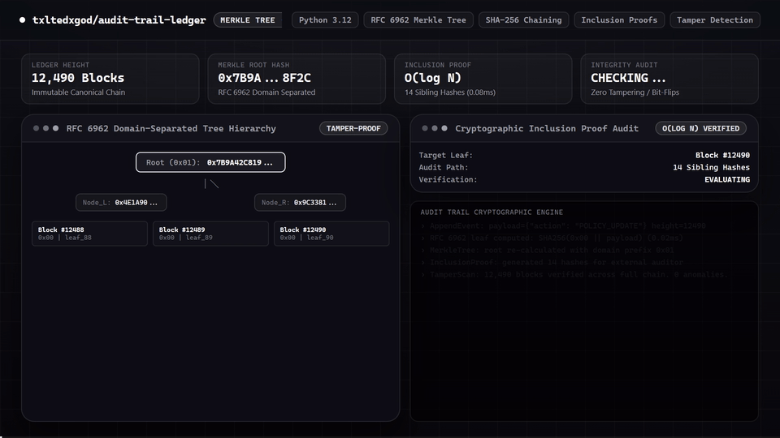

# Audit Trail Ledger

[](https://github.com/txltedxgod/audit-trail-ledger/actions)
[](LICENSE)
[](https://www.python.org/)

Cryptographically verifiable immutable audit log ledger in Python 3.11+ with RFC 6962 domain-separated Merkle trees, `O(log N)` inclusion proofs, canonical SHA-256 hash chaining, and full tamper detection.

---

## 🎬 Feature Demo

<p align="center">
  
</p>
<p align="center">
  <sub><a href="assets/demo.mp4">Watch / Download 1080p60 MP4</a></sub>
</p>

---
## Features
- **RFC 6962 Merkle Tree**: Separate domain prefixes (`0x00` leaves, `0x01` internal nodes) and power-of-two subtree splitting eliminate second-preimage and duplicate-leaf malleability attacks.
- **Full Chain & Digest Re-Verification**: `verify_integrity_report()` recomputes canonical JSON SHA-256 hashes, leaf digests, sequence numbers, and `prev_hash` links across every block.
- **REST API**: `/health`, `POST`/`GET /api/v1/events`, `GET /api/v1/merkle/root`, `GET /api/v1/merkle/proof/{index}`, `POST /api/v1/merkle/verify`, `GET /api/v1/integrity`.

## Testing
```bash
ruff check .
pytest -v tests/
```
